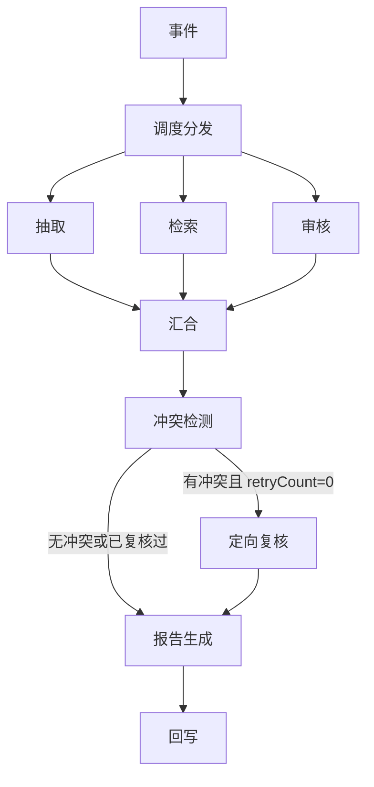

# 多智能体内容治理服务 — 需求（AI 侧）

> Python + LangGraph 实现。对每条新帖产出**摘要 + 相似帖推荐 + 风险评估报告**。
> **只出建议，不做处置**——最终决定由吧务点击确认。
>
> 本服务是**旁路增强**，不是重写社区。怎么和已有的 Java 平台咬合，见 §1。

## 0. 职责边界

**本服务负责**

- LangGraph 编排
- 五个 Agent 的推理
- 产出结构化结论并回写

**本服务不负责**

| | 由谁 |
| 业务数据读写 | 经 **MCP 工具**（Java 侧提供），不直连 `community` schema —— 见 §1.3 |
| 落库 | Java 侧，本服务只提交结论 |
| 最终处置 | **吧务点击确认**，本服务不自动处置 |
| 向量库（PostgreSQL + pgvector 的 `ai` schema） | 本服务独占，Java 不碰 —— 见 §1.1 |

> **「不直连业务 schema」是硬边界**：Python 使用专用 `ai_agent` 账号，
> 数据库权限只覆盖 `ai` schema，禁止访问 `community` schema。
> 帖子、吧规等权威业务数据仍走 MCP；`community.post_vectors` 只是 AI 自有检索副本。

---

## 1. 与传统业务的结合

> 本章回答一个问题：**一个不碰业务库的 AI 服务，怎么和已经跑着的 Java 社区平台拼在一起。**
>
> 现有平台（`lucky-core-service`）已经具备吧 / 帖 / 用户 / 权限 / 缓存一整套能力，
> 本服务是在它旁边挂上去的。所以结合方式必须是 **Java 主导、AI 旁挂**，不是两边对等。

### 1.1 谁拥有什么

| 数据 | 归属 | 另一方怎么拿到 | 说明 |
|---|---|---|---|
| `tb_post` / `tb_bar` / 用户 | Java 独占 | 经 MCP 工具读 | Python 永不直连 |
| `tb_bar_manager`（吧务任命） | Java 独占 | 不需要 | 本服务不参与权限判定 |
| `tb_post_analysis` | Java 独占 | 本服务出结论，Java 写 | 见 §1.5 时序 A |
| **向量（`community.post_vectors`）** | **Python 独占** | Java 不碰 | Java 只发「帖子有变更」信号 |
| **提示词（`community.prompt_templates` + Redis）** | **Python 独占** | Java 不碰 | PostgreSQL 存权威版本，Redis 存运行时缓存 |
| 模型 / Embedding 调用 | Python 独占 | Java 不碰 | Java 侧不知道也不关心用的哪个模型 |

一句话：**同一 PostgreSQL 实例、两个隔离 schema。`community` 归 Java，`ai` 归 Python，只共享 `postId`；Redis 共用实例但按 key 前缀隔离。**

划清楚之后，「删帖要同步删向量」这种跨侧动作才有明确的责任方（见 §1.5 时序 B）——
否则会出现「Java 以为 Python 会删、Python 以为 Java 会通知」的经典空白。

### 1.2 四条通道

四条，方向不同，失败策略也不同。**不要合并成一条笼统的「RPC」**：

```
        ┌──────────────── Java 业务侧 ────────────────┐
        │       community schema / MinIO ← Java 独占    │
        └───┬──────────────▲──────────────▲───────────┘
   ①推事件 │              │ ③推结论       │ ④吧务处置
   (HTTP)  ▼              │  (HTTP)      │  (已有业务动作)
        ┌────────────────┴────────────────┴───────────┐
        │ Python AI 侧：community / 模型 / Redis 提示词缓存 │
        └───────────────┬─────────────────────────────┘
   ②拉知识 │ (MCP)
          ▼
```

| # | 方向 | 通道 | 触发时机 | 失败后果 | 失败策略 |
|---|---|---|---|---|---|
| ① 事件流入 | Java → AI | HTTP（后续可换 MQ，见 §8-5） | 发帖事务提交后 | 该帖没有 AI 结论 | **吞掉，绝不影响发帖** |
| ② 知识拉取 | AI → Java | **MCP 工具** | 检索 / 审核 Agent 运行时 | 该次推理降级 | 超时即降级，见 §3.1 |
| ③ 结论回流 | AI → Java | HTTP | 推理完成 | 结论丢失 | 可重投，靠 `uk_post_id` 幂等 |
| ④ 处置回写 | 吧务 → Java | 已有 Web 接口 | 吧务点击确认 | 判例库不更新 | 见 §1.5 时序 C |

**① 和 ③ 是一件事的两半，但不要做成同一条连接。**

现有实现（`AiModerationService`）是「Java 起线程 → 发 HTTP → 阻塞等结果 → 自己写库」，
好处是不需要入站接口、不担心伪造；坏处是**一个线程被占满整轮推理（最坏 25s）**，
线程池打满就丢任务，而且应用重启时在途任务全丢。

若改成 ③ 独立回写，就要新增一个**入站接口**——那就必须解决鉴权，否则任何能碰到
这个端口的人都能伪造审核结果写库。这是个还没定的决策，见 §8-6。

### 1.3 MCP 工具清单

**MCP Server 由 Java 侧提供**（它是业务库的唯一拥有者），Python 作为 client 调用。
这样 Python 即使持有 PostgreSQL 连接串，也无法越权读取业务表。

| 工具 | 用途 | 谁调 | 落到现有资产 |
|---|---|---|---|
| `get_post(postId)` | 回溯复核时重读原文 | 审核 | `tb_post` |
| `search_posts(barId, query, k, excludePostId)` | 关键词通道召回 | 检索 | `tb_post`（需新增，见下） |
| `get_post_actions(postIds[])` | 批量取 `historicalAction` | 检索 | `tb_post_analysis.handler_action` |
| `get_bar(barId)` | 吧的基本信息 | 调度 | `tb_bar` |
| `get_bar_norms(barId, query)` | 吧规片段 | 审核 | **不存在，需新建** |

三个要点：

- **`get_post_actions` 必须批量。** 检索回来 10 条相似帖，逐条查就是 10 次跨进程往返，
  在 2s 的检索超时（§3.1）里根本跑不完。入参是**数组**，出参是 `postId → action` 映射。

- **当前检索在 `community.post_vectors` 内完成。** 语义向量和关键词全文检索双通道
  都只读取 AI 自有副本，再用 RRF 融合；不读取 `community.tb_post`。

- **`get_bar_norms` 对应的表在现有业务里完全没有。** 现在没有任何地方存「社区规范」，
  §6 的 `norm_vectors` 要的 `docId / section` 也就无从谈起。
  这是**必须先在 Java 侧补的业务能力**，AI 侧无法自己解决。

### 1.4 什么不该走 MCP

判断标准很简单：**这份数据的唯一拥有者是不是 Java。**

| 数据 | 走不走 MCP | 理由 |
|---|---|---|
| 帖子正文 / 处置状态 / 吧规 | ✅ 走 | Java 独占，Python 没有别的途径 |
| **向量检索（pgvector）** | ❌ 不走 | `ai` schema 是 AI 侧自有存储，绕回 Java 再查纯属浪费 |
| Embedding / 模型调用 | ❌ 不走 | 同上，且 Java 不该感知 |
| 帖子图片 | ⚠️ 待定 | 见下 |

**关于图片**：事件里给的是 `http://.../post/xxx.png` 这种 MinIO 直链，
意味着**帖子图片必须对外可读**。若哪天 MinIO 收紧成私有桶，这条链路会**静默失效**——
模型读不到图 → 抽取 Agent 只看到文字 → 摘要质量下降，而且**不会报任何错**。

要么保持公读，要么让 Java 在事件里带**预签名 URL**（注意有效期必须覆盖最坏 25s 的推理窗口，
且事件重投时要重新签发，不能复用过期 URL）。

### 1.5 三条关键时序

**时序 A：发帖 → 出结论**

```
用户                 Java                        Python
 │  发帖              │                            │
 ├───────────────────>│                            │
 │                    │ insert tb_post (status=0)  │
 │                    │ bloomFilter.add            │
 │  ← 立即返回详情 ────┤                            │
 │   (不等 AI)         │ ── afterCommit ──┐        │
 │                    │                  │        │
 │                    │ ①推事件 ─────────┴───────>│
 │                    │                            │ 编排 + 三路并行
 │                    │                            │ ├─ MCP ② 拉历史帖/吧规
 │                    │ ③结论回写 <───────────────┤
 │                    │ upsert tb_post_analysis    │
 │                    │ update analysis_status=2   │
 │                    │ 缓存失效广播（已有通道）    │
 │  刷新详情 ←────────┤ 摘要/相似帖/风险 出现了     │
```

要点：**用户从始至终没被阻塞过。** `analysis_status` 是详情接口的合并点——
发帖时是 0，AI 结论到了变 2，前端据此决定要不要显示「分析中」。
`PostCacheInvalidator` 已经有了跨实例 L1 失效通道，结论写入后调一次 `evict` 即可，
**不需要为这个功能新建广播机制**。

**时序 B：删帖 → 删向量**

```
吧务/作者          Java                        Python
 │  删帖            │                            │
 ├─────────────────>│ 逻辑删除 tb_post            │
 │                  │ PostCacheInvalidator.evict  │
 │                  │ ①推「帖子已删」信号 ──────>│
 │                  │                            │ pgvector delete by post_id
 │  立即成功 ←───────┤                            │
```

**HTTP 删除信号已经实现，但重试与定期对账仍待补：**

- 漏删 → 检索会召回一条已经不存在的帖子，**并把它推荐给用户**（§10 验收 5 就是测这个）
- 删失败 → 必须有重试或对账，否则静默残留、越积越多

**别指望信号可靠。** 逻辑删除可能从后台脚本、数据订正、运维手工等任何地方发生，
不一定走那个发信号的接口。所以除了信号，还要加**定期对账**：
每天扫一遍 `community.post_vectors` 里的 `post_id`，反查 Java 确认帖子还在不在，不在就清掉。

**时序 C：吧务处置 → 判例库更新**

```
吧务               Java                        Python
 │  点「确认删帖」   │                            │
 ├─────────────────>│ tb_post 逻辑删除             │
 │                  │ tb_post_analysis            │
 │                  │   .handler_action = '删帖'   │
 │                  │                            │
 │                  │  同步处置动作 ─────────────>│ 更新 community.post_vectors
 │                  │  下次检索时                 │ → 返回「删帖」
 │                  │                            │ → historicalAction 不再恒为「未处置」
```

**这条是整个服务「能学乖」的唯一途径。** 没有它：

- `historicalAction` 永远返回「未处置」
- §4.1 冲突判据第 1 条（审核判违规但判例未处置）**永远触发**，回溯复核变成常态
- 线上评测（§7）拿不到 `handler_action`，分歧率无从算起

Java 侧已经有吧务处置入口，并在事务提交后把 `handler_action` 同步到 AI 检索副本。
同步失败不影响处置，但仍需要重试或定期对账。

### 1.6 失败域：AI 侧永远不能拖垮主站

现有 `AiModerationService` 的类注释已经把立场写死了：

> **铁律：审核链路上的任何失败都不能影响发帖**

新架构必须继承这条，并把边界扩到四条通道：

| 通道 | AI 侧全挂时，主站表现 |
|---|---|
| ① 推事件 | 发帖照常成功，帖子只是没有 AI 结论 |
| ② 被调 MCP | 与本服务无关，Java 侧**不需要做任何事** |
| ③ 回写 | 帖子正常显示，`analysis_status` 停在 0 或 3 |
| ④ 处置 | 吧务照常删帖封禁，只是判例库少一条 |

推论：**详情接口必须能在完全没有 AI 数据时正常返回。**
摘要、相似帖、风险标注全部是「有就显示，没有就不显示」，不能是必填字段。

### 1.7 与现有代码的落点对照

| 需要的能力 | 现状 | 归属 |
|---|---|---|
| 发帖后投递事件 | 事务提交后调用 `/govern` | Java，已实现 |
| 调 Python 治理 | `AiModerationService`（线程池 + RestClient） | Java，已实现 |
| 结论落库 | `postAnalysisMapper.upsert`，`uk_post_id` 幂等 | Java，已实现 |
| `evidence` 原文校验 | Python 侧 `validate.normalize()` 已实现 | Python |
| 详情页合并 AI 数据 | 摘要、相似帖ID、风险和冲突字段已合并 | Java，已实现 |
| 吧务处置入口 | 已有，并同步历史处置到 AI 检索副本 | Java，已实现 |
| 社区规范（吧规）存储 | **不存在** | Java，需新建 |
| MCP Server | **不存在**（除本文档外无任何实现） | Java，需新建 |
| 向量库 | PostgreSQL `community.post_vectors` + pgvector | Python，已实现 |
| LangGraph / 五个 Agent | 三路并行、规则冲突、单次复核、报告 | Python，已实现基础版 |

> 当前主流程已跑通；仍未完成的是 MCP Server、吧规存储、删除/处置同步的可靠重试与对账。

---

## 2. 契约

### 2.1 输入：事件（Java → 本服务）

```jsonc
{
  "post_id":  1234567890123,
  "user_id":  987654321,
  "bar_id":   1001,
  "title":    "帖子标题",
  "content": "帖子正文（不含标题）",
  "image_urls": ["http://.../post/xxx.png"]   // 可为空数组
}
```

> **发帖接口不等本服务。** 用户发帖立即成功，结论在数秒后异步出现在帖子页。

事件里**只带最小上下文**（正文 + 图片 + 归属），其余一律经 MCP 现拉。
这样事件体小、不用随业务表结构变化而改契约，也让「不直连业务 schema」落到实地。

### 2.2 内部数据结构

```
PostExtraction {                        // 抽取 Agent 产出
  title:        String                  // 原题；无标题则由模型生成
  summary:      String                  // ≤100 字
  entities:     List<String>            // 游戏名/地名/产品名
  topics:       List<String>            // 话题标签
  contentType:  Enum                    // 求助 | 分享 | 讨论 | 提问 | 其他
  language:     String
}

RetrievalResult {                       // 检索 Agent 产出
  similarPosts: [{
    postId, title, snippet, score,
    historicalAction: String            // 未处置 | 警告 | 删帖 | 封禁（经 MCP 拉取）
  }],
  norms: [{ docId, section, snippet, score }]
}

RiskAssessment {                        // 审核 Agent 产出（第一遍只看原文）
  riskLevel:   Enum                     // 无风险 | 低 | 中 | 高
  categories:  List<Enum>               // 广告引流 | 辱骂攻击 | 色情低俗 | 侵权 | 引战 | 违法
  confidence:  Float                    // 0~1
  evidence:    [{ field, quote, offset }]   // field = title | content
  citedNorms:  [{ docId, section }]     // 模型主动引用的条款；可为空。只用于冲突检测，不回写
  reasoning:   String
}

Conflict {                              // 冲突检测产出，纯规则，无模型
  type:     Enum                        // 见 §4.1
  claim:    String                      // 被质疑的那句结论
  anchors:  [{ field, quote, offset }]  // 要回看的原文位置；可为空
  counter:  String                      // 对立证据：判例动作或规范片段，从已有检索结果里摘
  question: String                      // 定向复核必须回答的一个问题
}

RecheckResult {                         // 定向复核产出。只修补审核结论
  resolutions: [{
    type:        Conflict.type
    decision:    Enum                   // 维持 | 修正 | 需人工
    explanation: String
  }]
  assessment: RiskAssessment            // 修补后的审核结论；抽取和检索结果原样保留
}

GovernanceReport = 摘要 + 相似帖推荐 + 风险评估
```

### 2.3 输出：回写 payload（本服务 → Java）

```jsonc
{
  "post_id":       1234567890123,
  "summary":       "≤100 字摘要",
  "assessment": {
    "risk_level":  "中",
    "categories":  ["广告引流"],
    "confidence":  0.83,
    "evidence":    [{ "field": "content", "quote": "原文连续子串", "offset": 12 }],
    "reasoning":   "..."
  },
  "retrieval": { "similar_posts": [
    { "post_id": 111, "title": "相似帖", "snippet": "...", "score": 0.91, "historical_action": "未处置" }
  ], "norms": [] },
  "has_conflict":  true,
  "conflict_type": "审核 vs 判例",
  "retry_count":   1,                    // 回溯复核次数
  "model_version": "claude-sonnet-5",
  "latency_ms":    8200,
  "token_cost":    3400
}
```

**同 `postId` 重投必须幂等**——Java 侧靠 `uk_post_id` 兜底，但本服务也不该产生重复副作用。

回写形态（同步等结果 vs 独立回调接口）尚未定稿，见 §8-6。

---

## 3. 流程

```
事件
  → 调度分发（不调用模型）
  → ┌ 抽取 ┐
    │ 检索 ├─ 三路并行，只读事件，互不等待 → 汇合
    └ 审核 ┘
  → 冲突检测（纯规则）
  → 有冲突且尚未复核 → 带着冲突点回溯原文（只修补审核结论）
  → 报告生成 → 回写
```

图上**没有回到抽取 / 检索 / 审核的边**。定向复核是单独一个节点，最多跑一次。



四条实现约束：

1. **三路只读事件。** 检索不等抽取的话题标签，审核不等检索的规范片段。谁先完成谁先写入状态，汇合点等三路都落地（含超时降级）。
2. **调度和冲突检测都不调用模型。** 分发是固定的三路；判冲突是 §4.1 的规则。1 秒预算里放不下一个模型调用。
3. **定向复核只回答冲突点。** 输入是冲突记录 + 对应原文切片 + 已经检索到的判例/规范。输出只允许改 `RiskAssessment`。摘要、相似帖、向量都不重算。
4. **任一节点失败都写降级标记，图继续走到回写。** 不存在「某路挂了就整单失败」。

### 3.1 为什么三路必须互不等待

§4 里检索的输入写成了 `PostExtraction`，审核的输入写成了「原文 + 命中的规范片段」。若照字面做，图会变成「抽取 → 检索 → 审核」的串行，最坏耗时 3+2+8+1+8+5，直接超过 25 秒，也和本节的并行图矛盾。

并行之后的输入改成：

| 路 | 第一遍实际输入 | 不再等待的东西 |
|---|---|---|
| 抽取 | 事件里的正文 + 图片 | — |
| 检索 | 调度本地拼的 query + `barId` + `postId` | 抽取的 `topics` / `entities` |
| 审核 | 事件里的正文 + 图片 | 检索回来的规范片段 |

调度拼 query 的规则（本地、无模型）：事件里有可用标题就用标题，否则取正文前 200 字。抽取超时不再承担「给检索造 query」的职责——检索在抽取超时之前就该跑完（2s vs 3s）。

抽取的 `topics` / `entities` / `contentType` 只进入冲突检测和报告。审核第一遍若主动写下 `citedNorms`，汇合后用检索结果验它引的条款在不在命中列表里；验不过就生成「规范不一致」，交给定向复核，而不是让审核在第一遍阻塞等检索。

### 3.2 状态

一条帖子一次推理一份状态，节点按字段写入，汇合时不互相覆盖。

```
GovernanceState {
  event:            输入事件                         // 只读
  retrievalQuery:   String                          // 调度写入
  extraction:       PostExtraction | null
  retrieval:        RetrievalResult | null
  assessment:       RiskAssessment | null           // 复核后会被替换为修补版
  conflicts:        List<Conflict>                  // 冲突检测写入；无冲突则为空
  recheck:          RecheckResult | null
  retryCount:       Int                             // 0 或 1
  report:           GovernanceReport | null
  degradedReasons:  List<String>                    // 各节点追加，不互相覆盖
  timingsMs:        Map<阶段, Int>
}
```

`degradedReasons` 用追加语义：三路并行写同一列表时不能后写覆盖先写。

### 3.3 节点

| 节点 | 做什么 | 不做什么 |
|---|---|---|
| **调度分发** | 校验 `postId` / `barId` / `content`；拼 `retrievalQuery`；同时启动三路 | 不调用模型，不读 MCP |
| **抽取** | 产出 `PostExtraction` | 不检索、不判风险 |
| **检索** | 向量 + 关键词，RRF 融合；MCP 批量取 `historicalAction`；带 `barId` | 不改写帖子，检索为空是合法结果 |
| **审核** | 只根据原文产出 `RiskAssessment`（含可选 `citedNorms`） | 第一遍不调 `get_bar_norms` |
| **汇合** | 三路都结束后放行；缺的一路补上降级占位 | 不推理 |
| **冲突检测** | 按 §4.1 生成 `Conflict` 列表 | 不调用模型，不改三路结论 |
| **定向复核** | 见 §3.4 | 不重跑抽取、不重新检索、不第二次复核 |
| **报告生成** | 把已有结论组织成报告 | 不引入新事实 |
| **回写** | 按 §2.3 提交；`retryCount` 即复核次数 | 图内不重试业务写库；失败靠事件重投 + `uk_post_id` |

### 3.4 定向复核

触发条件：`conflicts` 非空，且 `retryCount = 0`。跑完 `retryCount` 置 1，然后**一律进入报告**。复核之后又发现新冲突，不再开第二轮。

一次复核的输入包：

| 材料 | 来源 | 范围 |
|---|---|---|
| 冲突列表 | 冲突检测 | 全部，每条自带 `question` |
| 原文切片 | 事件正文；引用对不上时才调 MCP `get_post` | 每条 `anchor` 前后各 80 字。正文 ≤1500 字时带整篇 |
| 对立证据 | 已有的 `RetrievalResult` | 只摘和该冲突相关的相似帖动作、规范片段 |
| 当前审核结论 | 状态里的 `assessment` | 整份，供对照 |

模型对每条冲突只回答 `维持 | 修正 | 需人工`，并给一句解释。选择「修正」时必须交回一份新的 `RiskAssessment`，其中 `evidence.quote` 仍须是原文连续子串。抽取结果和检索结果保持第一遍的值。

`get_post` 是例外路径。事件里已经带了正文；只有某条引用在事件正文中找不到时，才回 Java 拉权威原文，再用权威原文切同样的窗口。这一步不是把三路重跑一遍。

复核节点自己超时或失败：不改 `assessment`，追加降级原因「需人工复核」，照常进报告。

### 3.5 多条冲突时回写哪个 `conflictType`

§2.3 的 `conflictType` 是单值。同时命中多条时，按下表取优先级最高的一条写入该字段，其余冲突的 `question` 与复核解释进入 `reasoning`。

| 优先级 | 类型 |
|---|---|
| 1 | 依据缺失 |
| 2 | 规范不一致 |
| 3 | 审核 vs 判例 |
| 4 | 抽取 vs 审核 |
| 5 | 置信度不足 |

### 3.6 超时预算与对应降级

| 阶段 | 并行/串行 | 超时 | 超时后 |
|---|---|---|---|
| 抽取 | 并行 | 3s | `extraction=null`，报告里摘要改用正文前 100 字，`contentType` 记「其他」 |
| 检索 | 并行 | 2s | `retrieval` 置空：不推荐相似帖，规范类冲突不触发 |
| 审核 | 并行 | 8s | 降级为敏感词规则，`confidence=0`，标记「需人工」 |
| 冲突检测 | 串行 | 1s | 跳过复核，直接出报告 |
| 定向复核（条件触发） | 串行 | 8s | 不改审核结论，标记「需人工复核」 |
| 报告生成 | 串行 | 5s | 只返回风险等级，不出完整报告 |
| **总计最坏** | | **≤25s** | 并行取最慢一路 8s，再加检测 1s + 复核 8s + 报告 5s |

> **任一 Agent 挂掉都不能让主流程失败**——降级后照样回写结论，只是标注「需人工」。

**注意超时预算是按「MCP 调用不超时」估的。** 检索 2s 里要含一次 MCP 往返 + 一次向量查询，
如果 MCP Server 和 AI 服务不同机，网络抖动会直接吃掉大半预算。
部署时应尽量同机/同内网，并把 MCP 客户端超时设得比阶段超时更短（比如 1.5s），
让降级走「检索为空」这条合法路径，而不是让整个阶段被上层掐掉。

---

## 4. 五个 Agent

调度和冲突检测是图上的节点，不单独调模型。五个会调模型或检索的角色如下。

| Agent | 输入 | 输出 | 硬约束 |
|---|---|---|---|
| **帖子抽取** | 事件正文 + 图片 | `PostExtraction` | `summary` 必须是原文压缩，**不得引入原文没有的内容** |
| **检索 RAG** | 调度拼的 query + `barId` + `postId` | `RetrievalResult` | 双通道（向量+关键词）RRF 融合；**必带 `historicalAction`**；**必须带 `barId` 过滤，禁止跨吧召回**；检索为空是合法结果，不得编造 |
| **风控审核** | 事件正文 + 图片 | `RiskAssessment` | **无引用不下结论**（`evidence` 为空则必须判「无风险」）。第一遍不读规范；`citedNorms` 只供汇合后对账 |
| **定向复核** | `Conflict` 列表 + 原文切片 + 已有检索摘录 | 修补后的 `RiskAssessment` | 只回答每条冲突的 `question`；不重算摘要、不重新检索；最多一次 |
| **报告生成** | 状态里已有的抽取、检索、审核、复核 | `GovernanceReport` | 只做组织与措辞，**不得引入新事实**；每条结论必须可追溯；推荐必须标注来源 `postId` |

### 4.1 冲突判据

检测是纯规则，命中即生成一条 `Conflict`（含 `question`），交给 §3.4 的定向复核。检索结果为空时，依赖判例或规范的两条**不触发**——没有对立证据就不是冲突。

| 类型 | 判据 | `question` 要问的事 |
|---|---|---|
| 审核 vs 判例 | `riskLevel ≠ 无风险`，且存在 `score ≥ 0.75` 的相似帖，这些帖的 `historicalAction` **全部**是「未处置」 | 相似判例都未处置，原文里哪一处仍足以支持违规 |
| 抽取 vs 审核 | `contentType` 为「求助」或「讨论」，且分类含「广告引流」 | 这是求助/讨论，还是广告；引用原文说明 |
| 置信度不足 | `confidence < 0.7` 且 `riskLevel ≠ 无风险` | 维持该等级，或改判；必须重给原文引用 |
| 依据缺失 | `riskLevel ≠ 无风险` 但 `evidence` 为空 | 结论先作废（视为无有效等级）；若仍认为违规，给出原文连续子串 |
| 规范不一致 | `citedNorms` 中有条目不在 `retrieval.norms` 里 | 只允许沿用检索命中的条款，或改口为不引用规范 |

> **「审核 vs 判例」依赖时序 C。** 吧务处置入口建起来之前，相似帖的 `historicalAction` 全是「未处置」，只要召回分 ≥ 0.75 这条就会命中，定向复核会变成常态。0.75 这条线用来挡住弱相关召回，挡不住「全体未处置」。上线顺序上仍要先有时序 C，否则 8 秒复核会成为主要延迟。
>
> **「置信度不足」不覆盖「无风险」。** 无风险且低置信度不再开复核：硬约束已经要求无引用即无风险，复核没有可改的违规结论。漏检靠评测集看，不靠这条规则补。

---

## 5. 抑制幻觉的硬约束

这四条是**本服务的核心约束**，不是「尽量」：

1. **无引用不下结论**——`evidence` 为空时，`riskLevel` 必须为「无风险」，`reasoning` 说明「无充分依据」
2. **`evidence.quote` 必须是原文的连续子串**（最终由 Java 侧回写时校验，不匹配的条目会被丢弃——所以**给了假引用等于没给**）
3. **引用社区规范时，条款必须来自检索结果**，不得凭空引用
4. **报告只做组织与措辞**，任何结论必须能追溯到上游某个 Agent 的输出

---

## 6. 向量侧（PostgreSQL + pgvector）

| 表 | 字段 | 内容 |
|---|---|---|
| `community.post_vectors` | `post_id`, `bar_id`, `embedding`, `chunk_index`, `title`, `content`, `historical_action` | AI 自有帖子检索副本 |
| `community.norm_vectors`（待建） | `doc_id`, `bar_id`, `section`, `embedding` | 社区规范片段 |

Python 使用 `ai_agent` 专用账号。`community.post_vectors` 可读写，`community.prompt_templates` 只读，其它业务表不授权。

**切块策略**

- 标题单独一条（语义浓缩、召回报率最高）
- 正文按长度切块；短帖整条不切
- **每条必须携带 `bar_id`**，用于检索过滤

**同步**

- 发帖后异步入库，失败可重试
- **删帖必须同步删向量**——否则会检索到一条已经不存在的帖子，并把它推荐给用户。
  触发方与对账机制见 §1.5 时序 B
- **建库初期需要一次全量回填**：历史帖子本来就不在 `community.post_vectors` 里，
  不补的话检索 Agent 上线当天「相似帖推荐」是全空的，容易被误判成功能坏了

### 6.1 提示词存储（PostgreSQL + Redis）

提示词不以代码中的字符串常量作为线上权威来源：

- **PostgreSQL `community.prompt_templates` 是权威存储**，保存 `prompt_key`、`version`、`content`、
  `status`、`checksum`、`updated_at`；已发布版本不可原地覆盖，只能新增版本
- **Redis 是运行时缓存**，key 使用 `ai:prompt:{promptKey}:{version}`，并缓存当前生效版本；
  不得与 Java 业务缓存 key 混用
- 读取顺序为 **Redis → PostgreSQL → 进程内最后一次成功版本**。Redis 不可用时直读
  PostgreSQL；两者同时不可用时使用进程内旧版本并告警，不因提示词存储故障中断审核
- 发布新版本时先写 PostgreSQL，再删除对应 Redis 缓存；下一次读取回源并回填 Redis
- 每次推理结果和 trace 必须记录 `prompt_key + version + checksum`，保证评测与线上结果可复现

---

## 7. 评测

| 指标 | 定义 | 目标 |
|---|---|---|
| **漏检率** | 实际违规却判「无风险」的比例 | ≤5% |
| **误判率** | 实际正常却判「违规」的比例 | ≤10% |
| **幻觉率** | `evidence` 无法在原文中定位的比例 | **0** |
| 置信度校准 | 高置信度样本的实际准确率 | 偏差 ≤10% |
| 人工对照分歧率 | 本服务建议 vs 吧务决定 | 持续观测 |

> 漏检率目标**严于**误判率——漏放违规内容的代价高于多提醒一次。

- **评测集**：人工标注 200 条（含违规/正常，覆盖各类违规类型）
- **自动化回归**：模型/prompt 变更后重跑，对比指标
- **线上持续评测**：`handler_action`（吧务最终决定）与 AI 建议的分歧就是线上准确率，
  不需要额外标注——**但这条依赖时序 C**

---

## 8. 待定决策（阻塞编码）

| # | 决策 | 现状 |
|---|---|---|
| 1 | **冲突判据定稿** | §4.1 已按「纯规则 + 定向复核」写明五条及不触发条件；上线前仍需确认 0.75 召回阈值 |
| 2 | **LangSmith 合规** | 帖子内容会上传到 LangChain 服务。三选一：接受 / 自托管 / 只上报元数据 |
| 3 | **向量存储选型** | 已定 PostgreSQL + pgvector，使用独立 `ai` schema 和专用账号 |
| 4 | **LangGraph 是否必需** | 图已定为一次扇出、一次汇合、一条条件边（§3）。无环。用它只为这三件事，不用它做自由循环 |
| 5 | **队列选型** | 事件从 Java 过来走什么通道，取决于 Java 侧决策 |
| 6 | **回写形态** | 同步等结果（现实现）vs 独立回调接口。后者需定鉴权方案 |
| 7 | **MCP Server 实现** | Java 侧用什么提供（Spring AI MCP / 自建 JSON-RPC）。**阻塞 ② 通道全部工作** |
| 8 | **吧规从哪来** | 谁维护、什么格式、要不要管理界面。**阻塞 `get_bar_norms` 与 `norm_vectors`** |
| 9 | **吧务处置入口** | 已实现，处置动作在事务提交后同步到 AI 检索副本 |
| 10 | **图片可读性** | MinIO 保持公读，还是改预签名 URL（需覆盖 25s 推理窗口） |

> 当前主要阻塞项是 7 / 8：MCP Server 与吧规存储未完成，因此规范检索和权威原文回读仍会降级。

---

## 9. 里程碑

```
M0  Java 侧结合层            ← 进行中：处置已完成，MCP / 吧规待完成
M1  单 Agent 跑通            ← 已完成：审核 → 回写
M2  补齐抽取 / 检索 / 报告三个 Agent ← 已完成基础版
M3  LangGraph：扇出三路 → 规则冲突检测 → 定向复核 ← 已完成基础版
M4  LangSmith 接入 + 评测集 + 降级压测
```

> **M1 必须是单个 Agent**。管道不通就上多 Agent，出问题无法定位。
>
> **M0 是新增的，而且它不在 AI 侧。** 原始里程碑直接从 M1 开始，隐含假设了
> MCP 工具已经存在——实际上它在 Java 侧一行代码都没有。M1 要验证的那条管道
> （「调 MCP 工具」）恰恰依赖 M0。这两个里程碑如果并行，M1 会因为没工具可调而空转。

---

## 10. 验收标准

1. 事件到达后 ≤30s 产出完整结论并回写
2. 每条风险结论都能定位到原文引用
3. 任一 Agent 超时或异常，仍能产出降级结果
4. 检索结果**不跨吧**（人工构造跨吧相似内容验证）
5. 删帖后向量同步删除，不再被检索到
6. 评测集上跑出漏检率/误判率，LangSmith 留下可复现的 trace
7. 同一 `postId` 重投 3 次，结果与副作用一致
8. **AI 侧完全停服时，发帖 / 看帖 / 吧务处置全部照常**（§1.6 的四条通道逐一演练）
9. `ai_agent` 能读写 `community.post_vectors`、只读 `community.prompt_templates`，不能读取其它业务表
10. Redis 清空或不可用时能从 `community.prompt_templates` 恢复提示词；每条推理 trace 可定位到具体提示词版本
